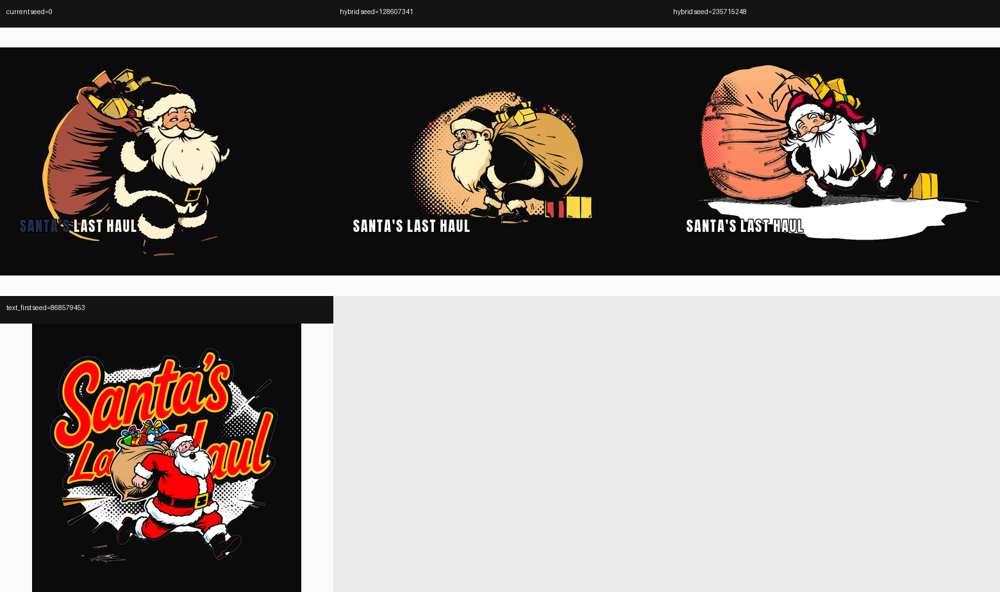
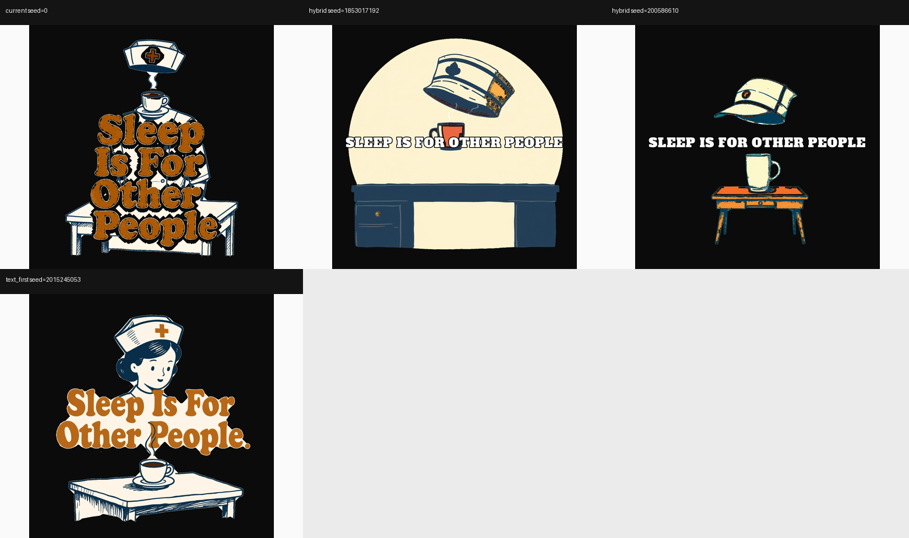
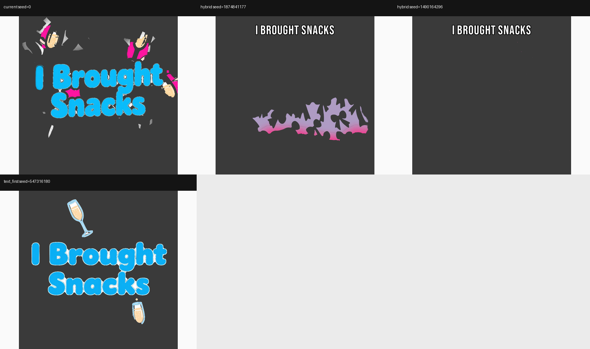
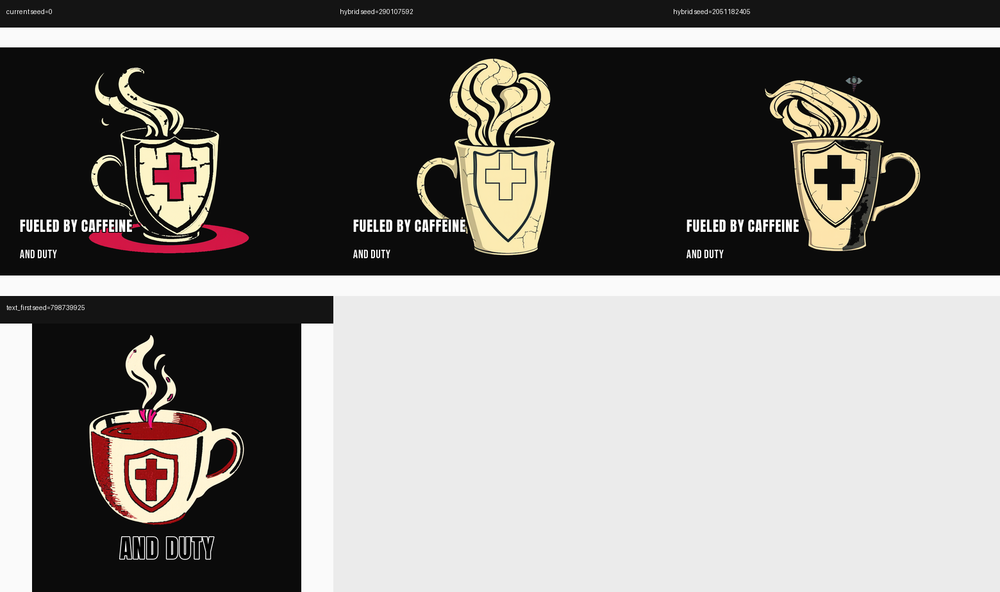
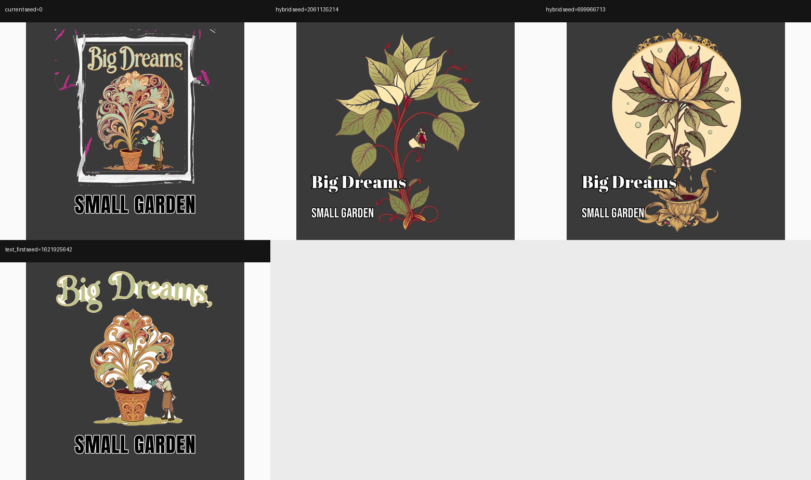
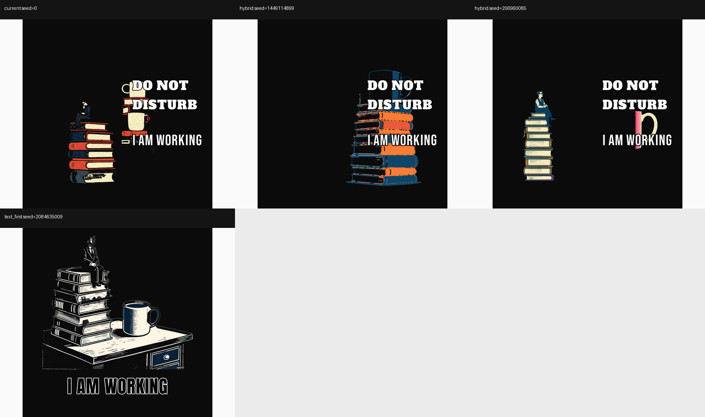

# Pipeline bake-off: current vs simplified hybrid vs text-first

Date: 2026-11-05
Issue: #304

## TL;DR

The simplest viable default is a **split**:

- **caption and no-text briefs:** Flux art on a magenta key + the deterministic
  compositor. No text plan, no carriers, no model-drawn text, no embedding
  profile.
- **type_hero briefs:** Qwen-Image draws the type and the scene. The
  deterministic hybrid is the wrong tool here: 204 has no scene, and 211's Flux
  art came back nearly empty. Qwen passed OCR on all three type_hero briefs.
- **always:** generate two candidates and select by a deterministic QA gate, and
  validate the text on the recommended garment colour rather than on the raw
  magenta/white render.

The current pipeline is not losing because it lacks rules. It is losing because
it asks the model to satisfy conflicting rules and then validates the wrong
surface.

## Question

The current pipeline has three text paths (deterministic compositor, Qwen
model-text, Qwen typographic hero), two image models, carriers, surfaces,
regions and text-embedding profiles. Recent renders still failed in ways the
gates did not catch:

- the first word of 213 was drawn in a dark accent on a Jet Black shirt;
- 206 left a magenta puddle in the transparent print file;
- 211 left magenta splatter and detached fragments;
- 209 and 207 had a cream sticker fill / white frame;
- 205 and 213 put the type on top of the subject.

This spike asks which architecture should be the default.

## Eval set

Fourteen completed DTF briefs, exported from the production database read-only:

| Briefs | What they cover |
|---|---|
| 205, 206, 207, 209, 210, 211, 213 | Known failures: contrast, key residue, sticker fill, placement |
| 204, 208, 212 | Hero and no-text baseline |
| 196, 198, 199, 201 | Neon, typographic, sticker and chalk methods |

The set covers all three voices, Jet Black and Dark Heather, `caption`/
`type_hero`/`no_text`, and every text method currently used.

## Arms

**current** - the production render already stored for each brief. No re-render;
this is the baseline the shop ships today.

**hybrid** - Flux draws the isolated subject on a magenta key. BiRefNet keys it.
The deterministic compositor draws the words. There is no text-plan carrier,
no model-drawn text and no embedding profile. The dark-garment prompt was
removed: the prompt never asks Flux to paint a black shirt. The accent word was
removed: 213 showed `loud` drawing the first word in a dark accent on a dark
garment. Two seeds were rendered per brief.

**text_first** - Qwen-Image draws the scene and the headline. The descriptor is
composited afterwards. This is the current hero/model-text strategy. One seed
per brief.

## Measurements

- `coverage` - opaque pixels / canvas. A DTF print should not be a solid sheet.
- `magenta_pct` - magenta pixels / ink. Chroma-key residue.
- `solid_light_pct` - the share of the artwork bbox that is a large light fill.
  This catches a cream sticker fill that coverage alone misses. It also flags
  legitimate white artwork, so the individual cases were checked visually.
- `near_white_border` - the strongest white band on opposite sides of the
  artwork bbox. A single white word on one edge is not a border.
- `text_overlap` - share of the composited text that sits on the subject.
- `contrast` / `accent_contrast` - WCAG contrast of the planned ink against the
  recommended garment colour. The current values are estimates from the plan;
  the current compositor can surface-correct, so the confirmed cases are called
  out below.
- `ocr_pass` - vision OCR on the current and text-first arms. The hybrid text is
  drawn from a font, so its spelling is exact by construction.

## Results

### Arm summary

| arm | n | coverage | magenta | light fill | white border | text overlap | min contrast | min accent | OCR | flagged |
|---|---|---|---|---|---|---|---|---|---|---|
| current | 14 | 23.0% | 2.8% | 35.2% | 11.7% | not measured | 1.04 | 1.16 | 100% | 14 |
| hybrid | 28 | 22.2% | 2.0% | 32.1% | 6.1% | 9.9% | 10.26 | - | n/a | 17 |
| text_first | 14 | 20.4% | 0.3% | 38.4% | 21.3% | n/a | - | - | 64% | 10 |

`flagged` means at least one heuristic threshold was crossed; it is a review
queue, not a verdict. The light-fill and border heuristics in particular flag
legitimate white artwork, so the known-failure briefs were checked visually.

The hybrid arm was also scored after picking the better of its two seeds by
text overlap, then magenta, then coverage:

| selected hybrid | n | coverage | magenta | white border | text overlap | min contrast |
|---|---|---|---|---|---|---|
| best seed per brief | 14 | 21.6% | 0.3% | 6.7% | 2.1% | 10.26 |

Selection alone takes the hybrid's mean text-on-subject from 9.9% to 2.1% with
no change to the model or prompt.

### Text-first OCR by copy mode

| copy mode | OCR pass |
|---|---|
| type_hero | 3 / 3 |
| caption | 4 / 9 |
| no_text | 2 / 2 (nothing to read) |

Qwen is the better typographic model, but it is not reliable for caption copy:
196, 199, 201, 205 and 206 all lost or garbled the headline.

### Known-failure briefs

| Brief | Current | Best hybrid seed | Text-first |
|---|---|---|---|
| 205 | Text on the mug stack; 2.4% magenta | Seed 2: 7.3% overlap, clean separation | OCR fail; large light fill |
| 206 | 25.7% magenta puddle under the mug | Clean, 0% magenta | OCR fail |
| 207 | White frame/backdrop; 1.8% magenta | Clean, 5.7% overlap | OCR pass, but 14.9% border and type cut at the top |
| 209 | Cream sticker fill, 43% white border | Seed 2: 13% coverage; the border heuristic flags the white hat/desk, but the contact sheet has no sticker ring | Sticker fill, 50.8% border |
| 210 | Black text on black, 1.66 contrast; 1% magenta | Clean, text visible, 0% overlap | Strong integrated type, 74.7% sticker border |
| 211 | 8.1% magenta splatter | Art nearly empty; 3.4% magenta | **Best:** OCR pass, clean two-glass design |
| 213 | Dark accent word, 1.5 contrast on Jet Black | Seed 1: 0% overlap, 0.2% magenta | Strong integrated type, but white sticker outline |

## Qualitative notes

**213 is the clearest example of the current bug.** The current file draws
"SANTA'S" in `#1F3050` on a Jet Black shirt; the accent word never goes through
the garment contrast correction. The hybrid seed 1 draws the same headline in
light ink with a dark outline, no accent word, no key residue, and no overlap.
The text-first arm produces a genuinely strong integrated lettering design, but
it wraps the lockup in a white die-cut outline, which the DTF guidelines forbid
by default.

**206 and 211 are chroma-key failures, not text failures.** The current prompt
asks for a black garment and a magenta key at the same time. 206 ships a
magenta puddle; 211 ships 8% magenta splatter. The simplified hybrid prompt
removes the black-shirt instruction and both failures disappear.

**209 and 207 are plate failures.** 209 prints a large cream sticker fill
(34% light fill, 43% white border). 207 prints a white rectangular frame around
the art. The hybrid removes both, but 209 has a bad seed: one hybrid seed is a
65%-coverage cream arch, the other is a clean 13%-coverage silhouette. Two
candidates and a coverage/overlap selection are enough to pick the clean one.

**211 and 204 are why text-first stays for type_hero.** 204 has no scene
description, so the hybrid has no art to draw. 211's scene is a seamless
pattern, and Flux returned an almost empty design; Qwen produced two champagne
glasses and readable type. The deterministic hybrid is not a universal
replacement.

**The remaining hybrid weakness is placement, and it is deterministic.** Two of
the hybrid seeds put the headline on the subject (205 seed 1 36.6%, 209 seed 1
98.4%, 213 seed 2 32%). The other seed for each brief is clean. This is not a
prompt problem; it is a candidate-selection problem.

## Contact sheets








Each sheet is current, hybrid seed A, hybrid seed B, text-first.

## Recommendation

1. **Default the caption and no_text paths to the simplified hybrid.**
   Keep Flux art, BiRefNet and the deterministic compositor. Remove the text
   plan, carriers, surfaces, regions, methods, model-text path and embedding
   profiles from the default path.
2. **Keep the text-first path for type_hero.** It passed OCR on all three hero
   briefs and handled the pattern scene that Flux could not. It still needs a
   sticker-border/trim gate and a descriptor pass.
3. **Render two hybrid candidates and select one deterministically.** Score by
   text overlap, then chroma residue, then coverage, then white border. This is
   the cheapest quality improvement in the spike: 9.9% mean overlap to 2.1%.
4. **Validate on the garment.** Composite the transparent file on the
   recommended shirt colour, then run OCR and contrast checks there. The
   current gate validates the raw/magenta render, which is why 210 and 213
   passed with text that disappears on the shirt.
5. **Keep the DTF rules in one place, not five prompts.** A single
   "isolated subject, no printed background, no text" prompt plus a deterministic
   validator replaces the carrier/surface/region/method layers.
6. **Do not add more prompt rules before the QA gate exists.** The next
   failure should be a rejection or a different seed, not another clause.

## What I would cut next

- `text_plan` carrier/surface/region/method/ink planning from the default path
- model-text and typographic-hero for caption briefs
- embedding profiles until the baseline print quality is stable
- the dark-garment "black is the shirt" prompt; replace it with post-key
  `remove_dark_ink`
- the accent word unless it is contrast-checked on the garment

## Reproduce

```bash
# generation on the DGX (app pod)
python spike/bakeoff/run_spike.py \
  --briefs spike/bakeoff/briefs.jsonl \
  --out /tmp/spike/out \
  --comfy-url http://192.168.2.123:8188 \
  --arms hybrid,text_first --seeds 2 --text-first-seeds 1

# scoring (with the vision model)
python spike/bakeoff/score_spike.py \
  --briefs spike/bakeoff/briefs.jsonl \
  --manifest /tmp/spike/out/manifest.jsonl \
  --out /tmp/spike/out --ocr-arms current,text_first

python spike/bakeoff/make_contact_sheets.py \
  --briefs spike/bakeoff/briefs.jsonl \
  --manifest /tmp/spike/out/manifest.jsonl --out /tmp/spike/out
```
